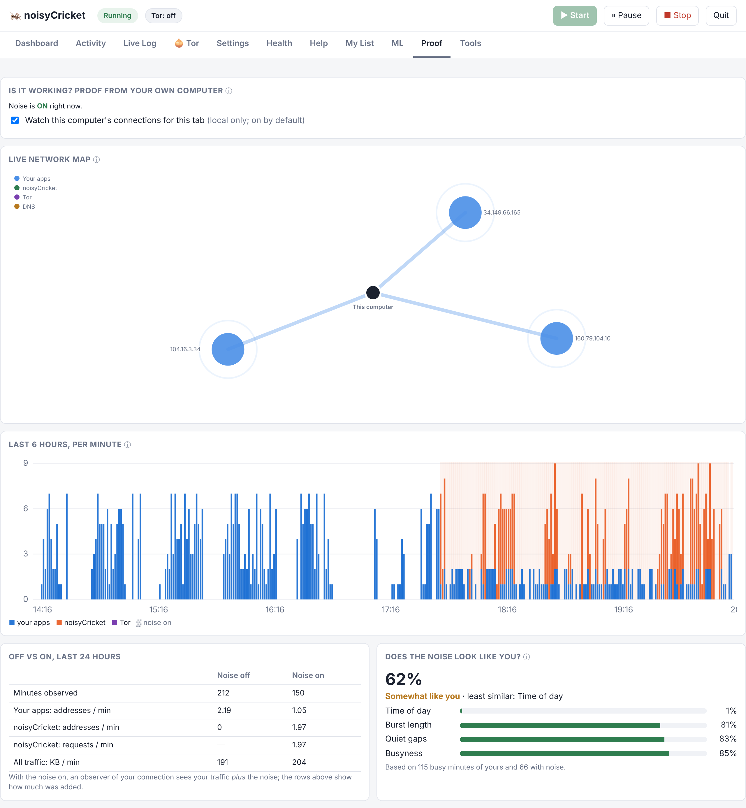
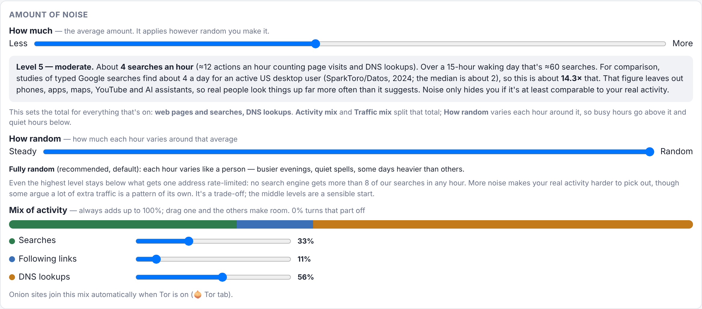
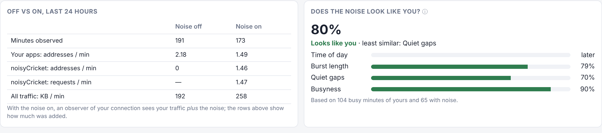
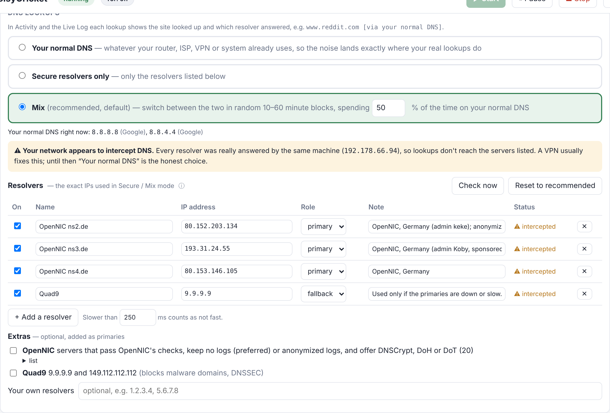
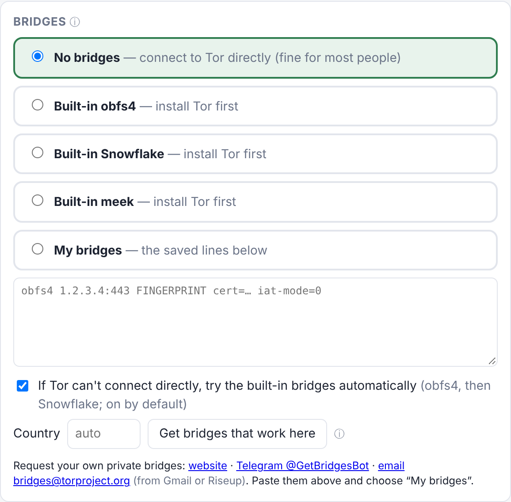

# legalPrivacy v2.9

legalPrivacy makes believable background browsing, searches and DNS lookups from your
computer, so that bulk analysis of your traffic tells much less about you. It runs in a
real browser, behaves like a person, follows a daily rhythm, and can make optional Tor
`.onion` noise. Everything it does is visible in a local dashboard, and nothing about your
activity is stored after it stops.

The name is a homage to the blog [*Legalizing Privacy*](https://legalizingprivacy.substack.com). This project was called noisyCricket until v2.9;
existing settings, start-up commands (`cricket`, `cricket-launch`) and `CRICKET_*` environment variables keep working.

<p align="center">
  
  <br><sub>The <b>Proof</b> tab: who this computer is talking to, your traffic with the noise off and on, and how much the noise looks like you (example data).</sub>
</p>

| | |
|---|---|
| <br><sub>How much noise, how random, and the mix</sub> | <br><sub>Off vs on, and the “looks like you” score (example data)</sub> |
| <br><sub>DNS: your resolvers, checked live</sub> | <br><sub>Tor bridges, built in or your own</sub> |

## Quick start

| You have | Do this |
|---|---|
| A release download | Double-click `legalprivacy-launch-windows.exe`, `legalprivacy-launch-macos` or `legalprivacy-launch-linux` |
| The source (Python 3.10+) | Double-click `Start-legalPrivacy.bat` (Windows) or `start-legalprivacy.command` (macOS/Linux). The first run sets up a private environment. |
| pip | `pip install .` then `legalprivacy-launch` (or `python -m legalprivacy`) |
| Docker | `docker compose up -d`, then `docker compose logs legalprivacy` for the dashboard link. See [docs/DOCKER.md](docs/DOCKER.md). |

Your browser opens the dashboard. The first run asks three questions (how much noise, whether
to add Tor `.onion` noise, whether to start automatically) and then starts. Every other setting
already has the recommended value, and settings save themselves as you change them.

## Dashboard

| Tab | What it's for |
|---|---|
| **Dashboard** | Hits, failures, uptime, data used today, hits per minute, a test hit |
| **Activity** | Every request: time, lane, engine, address, what the browser did (scrolls, depth, time on page, clicks, downloads), result, load time. A "Now" line shows the visit in progress. Download as CSV or JSON. |
| **Live Log** | Everything the app and Tor report, with level and source filters and search. Kept in memory only and cleared when the app quits. |
| **🧅 Tor** | Tor status and progress, Start / Stop / Restart / New identity / Install, live circuits, Tor's own log, onion sites, bridges |
| **Settings** | Amount and randomness, mix of activity, DNS, traffic mix and phones, user agent, extras, realism |
| **Health** | Plain-language self-checks |
| **Help** | What each part does |
| **My List** | Your own sites, which the noise visits most (see below) |
| **ML** | How easily your traffic can be told apart from the noise (see below) |
| **Tools** | Data-use estimate, privacy check, DNS leak check, speed test, clear the live log |
| **Proof** | A live EtherApe-style map of every machine this computer talks to, 6 hours of traffic per minute with the noise on/off periods shaded, and whether the noise's rhythm looks like yours |

The dashboard listens only on `127.0.0.1` and needs the token in its link. Settings live in
`~/.legalprivacy/config.yaml` (`%APPDATA%\legalPrivacy` on Windows); set `LEGALPRIVACY_HOME` to move them.

## How much, and when

- **How much** (1–10) is the average amount of everything that's on: web pages and searches,
  DNS lookups, and `.onion` sites when Tor is on.
- **How random** sets how much each hour varies around that average: 0% is the same every hour;
  100% (the default) varies like a person, with busier evenings, quiet spells and some days
  heavier than others. Anything in between is partly each.
- **Activity mix** and **Traffic mix** are bars that always add up to 100%: they split the total
  between searches, following links and DNS, and between a real browser, plain HTTP and `.onion` sites.

| Level | Searches an hour | Over a 15-hour day |
|---|---|---|
| 1 | 0.5 | ~8 |
| 3 | 1.5 | ~23 |
| 5 (default) | 4 | ~60 |
| 7 | 8 | ~120 |
| 10 | 20 | ~300 |

Even level 10 stays below what gets one address rate-limited: no search engine gets more than
8 searches an hour from legalPrivacy. Page visits and DNS lookups come on top of searches.

Activity comes in **sittings**: a few requests close together, then a longer gap, the way people
use a computer. The first action comes within seconds of pressing Start.

## Behaving like a person

When Chrome, Edge, Brave or Chromium is installed, legalPrivacy drives it in the background
(the window is hidden by default; you can also show it, or keep a real window off-screen).

- **Time on a page** is mostly short, with a long, rare tail: 1 in 25 visits last a minute or
  more, 1 in 100 three minutes or more, 1 in 500 ten minutes or more. Long visits keep moving:
  slow scrolls, glances back up, the mouse wandering.
- **Reading:** scrolling in eased bursts, pauses to read, scrolling back up, re-reading,
  hovering, now and then highlighting a line of text.
- **Search results pages:** a quick glance; or a look, half a screen down and a longer pause;
  or one smooth scroll and a stop. The top result is clicked about half the time.
- **Clicks** follow curved mouse paths, or taps on phones.
- **Now and then** a linked document is downloaded or an image saved, through the browser, and
  discarded.
- **Phones:** 55% of noise identities are phones, an **iPhone 13 with Safari** by default (or
  iPhone 15, iPhone SE, Pixel 7, Galaxy S24, or a mix), with the phone's screen and touch input.
- **Browser engine:** matches your own browser by default. If you use Firefox and Playwright's
  Firefox is installed (`python -m playwright install firefox`), the noise uses Firefox too.

### Cookies

Cookies are a trade-off: they're how sites track visitors, but a browser that never keeps any looks
like a brand-new visitor every time and gets far more "are you a robot?" checks. legalPrivacy keeps
**its own** cookies (never your browser's) for **about an hour** by default, then starts fresh. Each
set lives 60–140% of that time, so the resets don't happen on a fixed beat. Settings → Realism offers
"don't keep", 1 hour, 6 hours, 1 day, 1 week or 30 days, and the variation can be turned off.

### User agent

By default the noise uses **your own browser's user agent**, read automatically from your
installed browser, so it looks like you. Until it's known, it rotates. Settings → User agent also
offers random rotation (every hour or day) or one fixed entry, and lists the whole library:
Chrome, Chromium, Firefox (including ESR) and iPhone Safari releases from the last two years.

### Where searches and sites come from

| Source | What it is |
|---|---|
| Live trends | Google Trends, Wikipedia's most-read articles, BBC headlines |
| Real past searches | A random sample of real queries (MS MARCO, GooAQ) |
| Built-in topics, dictionary words | A small minority, and the offline fallback |
| Popular sites | The Tranco list, re-ranked by what real Chrome users load most (CrUX) |
| My List | Your own sites, when turned on |
| Interests | A few steady themes at a time, when turned on |

These lists ship with the app, so it never contacts those services for you unless you ask it to
refresh them (Settings → Realism).

**Safety filter.** Searches and sites are screened so the noise never visits anything
embarrassing or risky to have on your connection: adult, gambling, weapons, drugs, violence,
self-harm, hacking and government sites are blocked by word, by known-bad host lists and by
name patterns.

## My List

Your own sites. When it's on, most visits and DNS lookups come from them, with a share of other
sites mixed in (30% by default). Add them by hand (paste as many as you like), or find them:

- **Scan your browser history** (Chrome, Edge, Brave, Chromium, Firefox), read on this computer only
- **Import bookmarks** from your browsers
- **Import a file**: a bookmarks export (.html), a network log (.har: press F12, open the Network
  tab, browse a while, then "Export HAR"), Google Takeout history (`BrowserHistory.json`), or any
  list of addresses
- **Record** for 12, 24 or 48 hours: it counts only visits inside that window

Only site names and visit counts are read. You approve every site and choose how often each is
visited.

## ML: can your traffic be told apart from the noise?

The ML tab compares your real browsing (your browsers' history, read on this computer only) with
the noise, using only what your ISP or DNS provider could see: hour, weekday, rhythm, how popular
each site is, revisits and domain endings. A classifier tries to separate them, and you get:

- the **ROC AUC** (50% = can't tell them apart, 100% = trivial) with a 95% interval and per-fold scores
- the ROC curve, confusion matrix, accuracy, precision, recall, F1 and log loss
- which signals give the noise away, the specific values behind them, and the setting that fixes each
- when you browse versus when the noise runs, hour by hour
- a score history, an optional daily automatic run, and a quick "would this look like noise?" check

Nothing is sent anywhere; only the scores are kept.

## Proof: is it working, and does it look like you?

The **Proof** tab watches which addresses this computer is connected to, every 5 seconds,
and sorts each connection by the program that owns it: **your apps**, **legalPrivacy**
(including the browser it drives) or **Tor**. Nothing is captured or read and no
addresses are looked up. Your own connections are never named or saved; only
per-minute counts are kept, for 7 days, on this computer.

- **Live network map** (like EtherApe): a bubble per remote machine, colored by owner. Noise sites are named.
- **Last 6 hours:** connections per minute, split by owner, with the minutes the noise was on shaded.
  Stop the noise for a while, start it again, and the difference is visible.
- **Off vs on:** how much the noise adds per minute.
- **Does the noise look like you?** Compares the noise with your own traffic from the
  minutes the noise was off: time of day, length of busy bursts, length of quiet gaps,
  busyness of a busy minute. Each is a 0–100% similarity (1 − Kolmogorov–Smirnov distance).
  It needs about an hour of your own activity with the noise off before it can judge.
  The **ML** tab is the stronger test.

On macOS, other programs' connections are only visible when legalPrivacy runs as
administrator; otherwise the tab shows the noise only and says so. The watcher can be
switched off on the tab.

## DNS

| Setting | What it does |
|---|---|
| **Mix** (default) | Switches between your normal DNS and the secure resolvers in random 10–60 minute blocks, half the time each (adjustable) |
| **Your normal DNS** | Your computer's own resolver: router, ISP, VPN or your system's encrypted DNS |
| **Secure resolvers only** | Only the resolvers in the list in Settings. By default: OpenNIC ns2.de `80.152.203.134`, ns3.de `193.31.24.55` and ns4.de `80.153.146.105` as primaries, and Quad9 `9.9.9.9` as a fallback used only when they're down or slower than 250 ms. Every row is editable; extras: the whole OpenNIC directory, Quad9's pair, your own IPs. |

Each lookup in Activity shows which resolver answered it. **Check now** times each resolver and asks it for `whoami.akamai.net`, which reveals the machine that really answered. If something on your network secretly answers in their place (some ISPs, workplaces, hotels and cloud hosts do), the list says **⚠ intercepted**.

## Extras (Settings)

All optional:

- **Active hours:** only make noise between set times
- **Your own activity:** pause while you're using the connection, or run mostly while you're active
- **Interests:** a few steady themes at a time, changing every so often
- **Household:** noise from 2–5 virtual people with their own devices, browsers and hours
- **Search engines:** how often each is used
- **More typos** in searches, **polite mode** (no site twice within a minute), **low-data mode**,
  a **daily data cap**, **Prometheus metrics** at `/metrics`
- **Browser-like DNS** (on by default): also asks for IPv6 and HTTPS records

## Tor (optional)

**Bridges** (Tor tab), for networks that block Tor:
- **Built-in obfs4, Snowflake or meek:** taken from the official Tor bundle's own list, so they stay current with each Tor update.
- **My bridges:** your saved lines.
- **Automatic** (on by default): if Tor can't connect directly within about a minute, it tries the built-in obfs4 bridges, then Snowflake, like Tor Browser's Connection Assist.
- **Get bridges that work here:** asks the Tor Project's bridge service (bridges.torproject.org) for your country and saves the answer. It asks before contacting the service.
- **Request private bridges:** shortcuts to the [website](https://bridges.torproject.org/options), Telegram [@GetBridgesBot](https://t.me/GetBridgesBot), and email to bridges@torproject.org (from Gmail or Riseup).

On Tor, failures are handled like a person would: sometimes reload the page a minute or two later, sometimes move on, sometimes get a new identity first. A new identity follows 2–5 failures in a row, and circuits also change by themselves every 10–40 minutes.

**Test Tor** (Tor tab) checks that traffic really leaves through Tor and that the Tor Project's onion site loads. Tor errors are shown in plain English ("onion site is offline" rather than "0xf0").

| Switch | Default | What it does |
|---|---|---|
| **Tor** | off | When on, legalPrivacy runs its own private Tor (it finds `tor` on your computer or downloads and verifies the official Tor Expert Bundle). Your own Tor and Tor Browser are never touched. |
| **🧅 Onion sites** | on when Tor is on | Visits real v3 `.onion` addresses: official mirrors of lawful public sites, plus links found on them. Uses Tor Browser's uniform headers so it blends in. |
| **Ordinary web through Tor** | off | Not recommended: it burdens exit relays and is an unusual pattern. |

Many `.onion` sites are offline at any moment. Those show in Activity as "site offline" and are
skipped for a while; this is normal and doesn't mean Tor is broken.

- **Restart** stops and starts Tor itself, reconnecting to the network from scratch.
- **New identity** keeps Tor running and switches to fresh circuits.

**Bridges** hide from your network that you use Tor: add them on the Tor tab, or generate a
Snowflake client configuration with `legalprivacy relay gen-client --type snowflake`.

**Contribute to Tor** with `legalprivacy relay gen`, which writes a middle-relay or bridge
configuration. It never runs an exit.

## Privacy

- The live log and Activity are kept in memory only and cleared when the app quits; no log file
  is written.
- History, bookmarks and files you import are read on your computer; only site names and counts
  are used, and nothing is kept until you approve it.
- The dashboard is reachable only from your own computer.

## Command line

```
legalprivacy ui [--no-browser] [--port N]      # the dashboard
legalprivacy run --profile profiles/example.yaml [--verbose] [--once] [--dry-run]
legalprivacy doctor --profile profiles/example.yaml
legalprivacy tor status|start|install|newnym   # the app's private Tor
legalprivacy relay bridges | gen-client | gen  # bridges and relay configurations
```

## Development

Tests: `python3 run_tests.py`. The real-browser test is skipped when no browser is found.
Maintainer tools: `tools/build_feed_snapshot.py` rebuilds the bundled lists, and
`tools/build_ua_catalog.py` rebuilds the user-agent library from the official release calendars.
Design notes: [docs/DESIGN.md](docs/DESIGN.md). Legacy Java prototype: `legacy-src/`.
